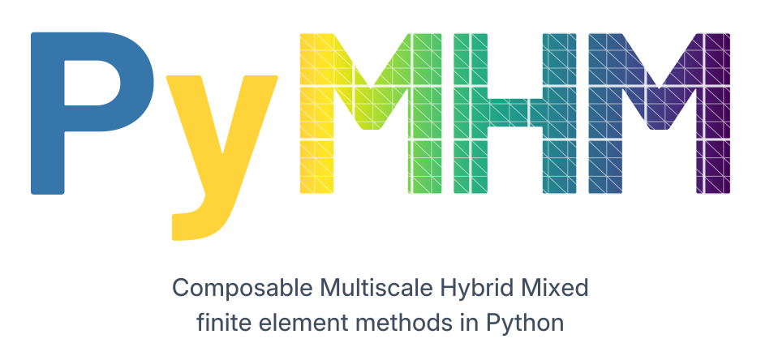
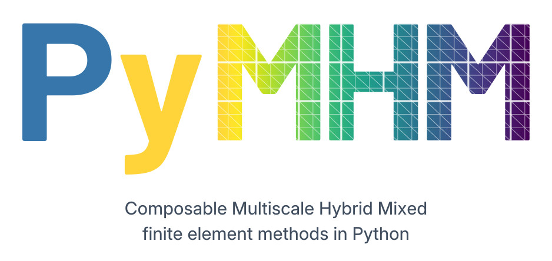
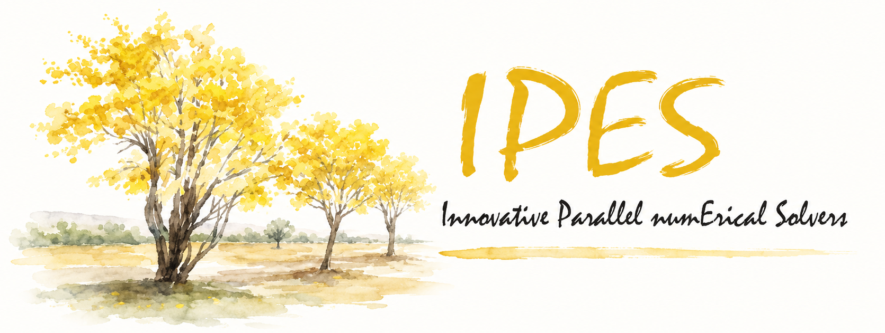
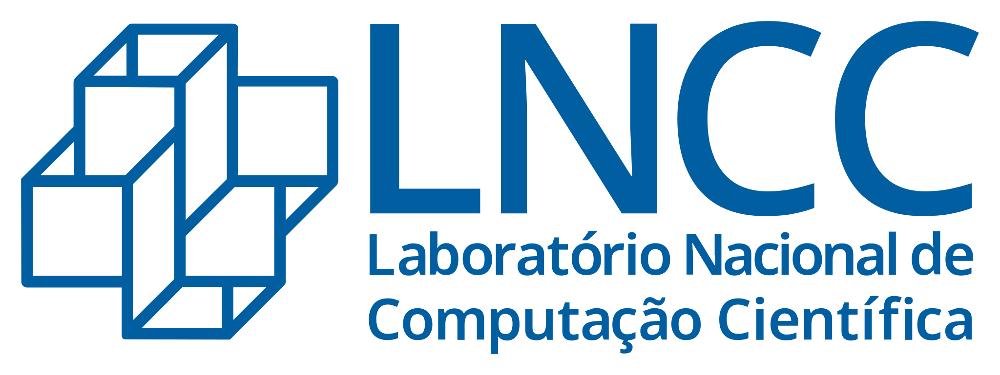

# Composable multiscale methods

  

    
    
Composable Multiscale Hybrid Mixed finite element methods in Python

  

  
  

`pymhm` is a Python package for Multiscale Hybrid Mixed (MHM) finite element
methods and related hybrid formulations. It lets you write the local and
global variational equations, choose their approximation spaces, and then
assemble, solve and reconstruct the physical fields.

## What is MHM?

Multiscale Hybrid Mixed (MHM) methods are derived from hybrid variational
formulations on a coarse partition of the domain into **macroelements**.
A decomposition of the space of element-wise fields gives an equivalent
global–local formulation: independent local problems and a coupled global
problem for interface multipliers and the field components in the local
operator kernels, when present. See
[Harder, Paredes and Valentin (2013)](https://doi.org/10.1016/j.jcp.2013.03.019) and [Harder and Valentin (2016)](https://doi.org/10.1007/978-3-319-41640-3_13) for further details.

In PyMHM, implementing a method means choosing the macro, skeleton and
local approximation spaces, writing its **local and global variational
equations**, and supplying a local solver. The package handles shared
interface numbering and geometric orientation, assembles the contributions,
and reconstructs the fields after the global solve. Local discretizations,
solvers and execution settings are separate choices. The
[Methods](methods.md) catalogue identifies the available constructions and
their primary references; the
[Tutorials](tutorials/overview.md) translate them into code step by step.

  <a href="installation/">
    <strong>Install PyMHM</strong>
    Set up the portable core and choose optional native backends.
  </a>
  <a class="pymhm-tutorial-card" href="tutorials/overview/">
    <strong>Start the tutorials</strong>
    New to PyMHM? Learn the API step by step with introductory cases, rendered code and field plots.
  </a>
  <a href="gallery/">
    <strong>Explore the Gallery</strong>
    Explore reservoir flow, heterogeneous solids, waves and parallel simulations.
  </a>

The reference implementation uses NumPy, SciPy and Basix. The optional
[FEniCS interface](fenics.md) assembles user-defined scalar, vector, mixed and
H(div) local forms with UFL/DOLFINx. [Meshing](meshing.md) connects Gmsh, Netgen
and meshio.

The [Windows guide](windows.md) covers the portable core, SciPy/PyPardiso,
spawn workers and installed-wheel verification, with the native FEM scope
stated separately.

Start with the [API overview tutorial](tutorials/overview.md) and the
[notebook catalogue](tutorials/notebooks.md) for scalar and vector
formulations and interchangeable local providers. Use the
[Gallery](gallery/index.md) for applications with problem data, variational
formulations, implementations and computed fields.

Follow **meshes → spaces → local equations → global equations → assembly
→ solution → physical fields and errors**. The [API overview](tutorials/overview.md)
implements this workflow with UFL. [Mesh binding](variational.md) connects
the local and global approximation spaces; a
[custom interface](guides/custom-interface.md) provides explicit control
of interface bases and maps when needed.

Local discretization, skeleton approximation and linear solvers are
separate choices. A provider can use another simulation library, or a
local operator can itself be another multiscale problem. The
[provider guide](guides/providers.md) explains how to connect these solvers.

## Available Methods

The package includes MHM formulations and related multiscale constructions.
Consult [Methods](methods.md) for the catalogue and the cited publications
for their mathematical definitions and assumptions. **Cite the publications
for every method and strategy used, together with the PyMHM version.**

| Formulation | Reference |
| --- | --- |
| Primal MHM | [Harder, Paredes and Valentin (2013)](https://doi.org/10.1016/j.jcp.2013.03.019) |
| Mixed H(div) MHM | [Durán et al. (2019)](https://doi.org/10.1016/j.cma.2019.05.013) |
| Petrov–Galerkin MHM | [Fernando et al. (2023)](https://doi.org/10.1007/s40314-023-02304-y) |
| Scalar RAD MHM | [Harder et al. (2015)](https://doi.org/10.1137/130938499); [Araya et al. (2024)](https://doi.org/10.1016/j.cma.2024.117089) |
| Stokes–Brinkman MHM | [Araya et al. (2017)](https://doi.org/10.1016/j.cma.2017.05.027) |
| Oseen MHM | [Araya et al. (2021)](https://doi.org/10.1007/s10444-020-09833-8) |
| Primal elasticity MHM | [Harder, Madureira and Valentin (2016)](https://doi.org/10.1051/m2an/2015046) |
| GaLS elasticity MHM | [Gomes, Pereira and Valentin (2024, preprint v1)](https://arxiv.org/abs/2403.16890v1) |
| Mixed elasticity MHM | [Devloo et al. (2021)](https://doi.org/10.1051/m2an/2021013) |
| Elastodynamic MHM | [Gomes et al. (2017)](https://doi.org/10.20906/CPS/CILAMCE2017-0399) |
| Helmholtz MHM | [Chaumont-Frelet and Valentin (2020)](https://doi.org/10.1137/19M1255616) |
| Maxwell MHM | [Lanteri et al. (2018)](https://doi.org/10.1137/16M110037X) |
| Robin Multiscale Hybrid method (MH) | [Barrenechea, Gomes and Paredes (2024)](https://doi.org/10.1137/22M1542556) |
| Three-field Multiscale Method (MH²M) | [de Barros, Madureira and Valentin (2026, preprint v3)](https://arxiv.org/abs/2404.16978v3) |
| Multiscale Hybrid High-Order method (MsHHO) | [Cicuttin, Ern and Lemaire (2019)](https://doi.org/10.1515/cmam-2018-0013); [Chaumont-Frelet et al. (2022)](https://doi.org/10.1051/m2an/2021082) |

Complementary strategies:

| Strategy | Reference |
| --- | --- |
| MHM-USFEM: stabilized reaction–diffusion local problems | [Martins, Pacazuca and Valentin (CILAMCE 2025)](https://doi.org/10.55592/cilamce2025.v5i.14270) |
| Independent skeletal refinement | [Paredes, Valentin and Versieux (2024)](https://doi.org/10.1016/j.cam.2023.115415) |
| Unfitted macro meshes with material-fitted skeletal partitions | [Chaumont-Frelet, Paredes and Valentin (2026)](https://doi.org/10.1016/j.camwa.2026.01.016) |
| Flux reconstruction and associated estimators | [Barrenechea et al. (2026)](https://doi.org/10.1137/24M1673073) |
| Residual estimators and adaptive refinement | [Araya et al. (2013)](https://doi.org/10.1137/120888223); [Araya, Rebolledo and Valentin (2021)](https://doi.org/10.1093/imanum/drz053) |

[Transient scalar integration](api/transport.md) and
[nested local/global providers](guides/providers.md) are also available
as software capabilities.

## Executable formulations

Write local and global equations through the shared variational API, then
assemble, solve and evaluate the resulting fields. The [feature overview](tutorials/overview.md)
introduces that workflow; the [API](api.md) documents the available scalar,
vector and mixed operators and their accepted inputs.

[Mesh generation and exchange](meshing.md), [local providers](guides/providers.md)
and [solver selection](solvers.md) are configured separately. Choose the geometry
and approximation spaces supported by the formulation you intend to implement.

## Reproducible examples

Application pages link to notebooks, material data and numerical records.
The [download guide](data.md) explains how to obtain those inputs and run the
examples with an installed PyMHM. Method tutorials include refinement plots
for their stated approximation spaces. Detailed [verification studies](cases/index.md)
and [performance reports](performance.md) are available under Development.

This is version 1.3.2, an official release of PyMHM. The
[installation guide](installation.md) explains package installation through pip,
optional backends and the locked environments used for reproducible studies.

<section class="institutional-support" markdown="1">

!!! info "Figure reuse and attribution"

    Original figures and diagrams are © IPES Research Group and licensed under
    [CC BY 4.0](https://creativecommons.org/licenses/by/4.0/). Commercial reuse and
    adaptations require attribution; see [figure reuse and attribution](licensing.md).

## Institutional Support

PyMHM is developed by the
[Innovative Parallel numErical Solvers (IPES)](https://ipes.lncc.br/)
research group and receives institutional support from the
[Laboratório Nacional de Computação Científica (LNCC)](https://www.gov.br/lncc/pt-br),
a research unit of the
[Ministério da Ciência, Tecnologia e Inovação (MCTI)](https://www.gov.br/mcti/pt-br),
Brazil.

  
  
  

</section>
