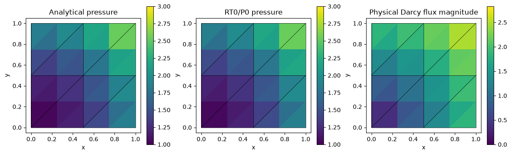
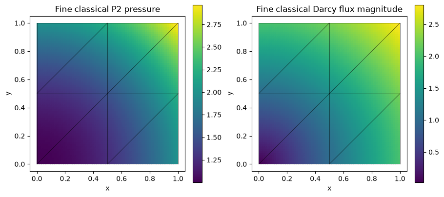
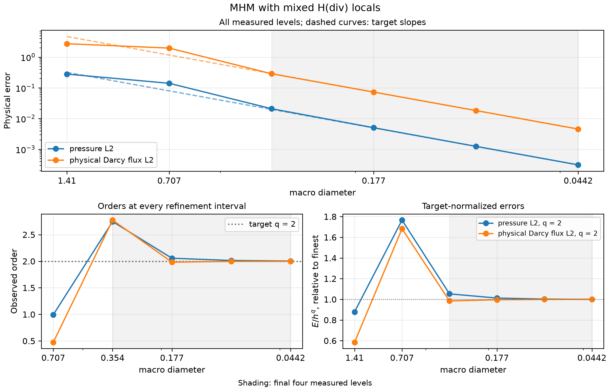

# MHM with mixed H(div) local problems

[Open the step-by-step notebook](https://github.com/ipes-lncc/pymhm/blob/main/notebooks/darcy/mixed_mhm_workflow.ipynb) · [Download notebook](https://raw.githubusercontent.com/ipes-lncc/pymhm/main/notebooks/darcy/mixed_mhm_workflow.ipynb)

We write every local block and the global boundary equation, then assemble, solve and evaluate the fields. No named Darcy constructor chooses the problem. The source is independently derived from $p=1+x^2+y^2$ and $q=-2(x,y)$: $f=\nabla\cdot q=-4$. Exterior pressure equals the analytical value.

The example uses portable Basix RT0/P0 local kernels. RT0 contains this affine radial flux; its P0 pressure is an approximation and should not be declared exact. The general mixed-local construction follows [Durán, Devloo, Gomes and Valentin (2019)](https://doi.org/10.1016/j.cma.2019.05.013).


```python
import numpy as np
import matplotlib.pyplot as plt
from scipy import sparse
from pymhm import Equation, LocalContext, MeshHierarchy, SkeletonSpace, TriangleMesh
from pymhm import assemble, bind_interface, bind_problem, solve
from pymhm.fem.scalar.operators import rt0_operators, rt0_evaluate, face_integration, triangle_quadrature


def exact_pressure(points: np.ndarray) -> np.ndarray:
    """Analytical nonhomogeneous boundary pressure."""
    return 1 + np.sum(points**2, axis=1)


def exact_flux(points: np.ndarray) -> np.ndarray:
    """Physical Darcy flux for identity permeability."""
    return -2 * points


def source(points: np.ndarray) -> np.ndarray:
    """Independently differentiated flux divergence."""
    return np.full(len(points), -4.0)
```

## 1. Define macro and local meshes

The P0 normal-flux skeleton controls the global approximation. Each macrotriangle has its own red-refined RT0/P0 local mesh. Numbering and face incidence come from the mesh and shared pairing owner.


```python
macro = TriangleMesh.unit_square(2)
local_meshes = tuple(macro.submesh(cell, 2) for cell in range(len(macro.cells)))
hierarchy = MeshHierarchy(macro, local_meshes)
skeleton = SkeletonSpace(macro)
interface = bind_interface(skeleton, convention="normal")
```

## 2. Translate the mixed weak problem into blocks


$$
\begin{aligned}
(K^{-1}q,r)_T-(p,\nabla\cdot r)_T+\langle\eta,r\cdot n_T\rangle_{\partial T}&=0,\\
-(\nabla\cdot q,w)_T&=-(f,w)_T,\\
\langle q\cdot n_T-\lambda_T,\xi\rangle_{\partial T}&=0.
\end{aligned}
$$


The flux, pressure and private boundary-pressure coefficients form $u_T=(q_T,p_T,\eta_T)$. The first two volume operators are $M$ and $D$; $N$ pairs boundary pressure with fine normal-flux coefficients. $F$ transports the skeletal normal-flux density to those integrated boundary coefficients.

The common Basix/FEM operations integrate these forms in their declared coefficient basis; the block matrix and signs below are the user's formulation. The final trace map already includes canonical normal incidence, so `coordinates="global"` explicitly avoids applying it again.


```python
def local_equations(local: LocalContext):
    """Declare the three mixed equations and their independent global test."""
    fine = local.mesh
    M, D, force = rt0_operators(fine, 1.0, source, order=6)
    _, F = face_integration(macro, local.cell, fine, skeleton)
    nq, npres, nb = len(fine.faces), len(fine.cells), len(fine.boundary_faces)
    N = sparse.coo_matrix((np.ones(nb), (fine.boundary_faces, np.arange(nb))),
                          shape=(nq, nb)).tocsc()
    zero = sparse.csc_matrix((npres, nb))
    a = sparse.bmat([[M, -D.T, N], [-D, None, zero],
                     [N.T, zero.T, None]], format="csc")
    b = np.zeros((nq + npres + nb, F.shape[1]))
    b[nq + npres:] = -F
    L = np.r_[np.zeros(nq), -force, np.zeros(nb)]
    constant_shift = np.r_[np.zeros(nq), np.ones(npres + nb)][:, None]
    pressure_integral = np.r_[np.zeros(nq), fine.areas, np.zeros(nb)][:, None]
    return local.equations(a=a, L=L, b=b, c=-b.T,
                          kernel=constant_shift, moments=pressure_integral,
                          coordinates="global", metadata=(fine, nq, npres))
```

## 3. Define the global boundary equation

The joint local kernel shifts pressure and auxiliary boundary pressure by the same constant. Its physical moment integrates only the volume pressure. The global pressure test uses $C=-B^T$; this mixed coefficient convention gives the **positive** Dirichlet boundary load. The primal pressure convention has a different load sign.


```python
def global_equation(global_context):
    """Declare weak exterior pressure in the mixed trace-test convention."""
    boundary, fixed = global_context.boundary_data(exact_pressure, order=6)
    assert not fixed
    return Equation(0, global_context.trace_load(boundary))


problem = bind_problem(hierarchy, interface, local_equations,
                       global_equation=global_equation, retained=1)
```

## 4. Assemble, solve and split the declared fields

The local block layout was explicitly declared, so the result can be interpreted without guessing coefficient locations. Auxiliary boundary pressure is not included in the physical pressure norm.


```python
system = assemble(problem)
coefficients = solve(system)
fields = []
for metadata, values in zip(system.local_metadata, coefficients.fields, strict=True):
    fine, nq, npres = metadata
    fields.append((fine, values[:nq], values[nq:nq + npres]))
assert coefficients.raw_residual < 1e-10
print({"original_equation_residual": coefficients.raw_residual})
```

```text
{'original_equation_residual': 9.127922134288862e-17}
```

## 5. Verify physical flux and fine-cell conservation

Integrate each field on its own fine cells. The RT0 physical flux is evaluated with the shared Piola/basis owner. Fine-cell conservation is imposed by the pressure/divergence equation; it is stronger than merely checking each macroelement's total outflow.


```python
bary, weights = triangle_quadrature(8)
pressure_squared, flux_squared, balance = 0.0, 0.0, []
for fine, q, p in fields:
    points = np.einsum("qi,tia->tqa", bary, fine.points[fine.cells])
    exact_p = exact_pressure(points.reshape(-1, 2)).reshape(points.shape[:2])
    exact_q = exact_flux(points.reshape(-1, 2)).reshape((*points.shape[:2], 2))
    q_values = rt0_evaluate(fine, q, bary)
    pressure_squared += fine.areas @ ((p[:, None] - exact_p)**2 @ weights)
    flux_squared += fine.areas @ (np.sum((q_values - exact_q)**2, axis=2) @ weights)
    _, divergence, force = rt0_operators(fine, 1.0, source, order=8)
    balance.append(np.max(abs(divergence @ q - force)))
assert np.sqrt(flux_squared) < 1e-10
assert max(balance) < 1e-10
print({"pressure_L2": float(np.sqrt(pressure_squared)),
       "physical_Darcy_flux_L2": float(np.sqrt(flux_squared)),
       "fine_cell_balance_max": float(max(balance))})
```

```text
{'pressure_L2': 0.1123841996605099, 'physical_Darcy_flux_L2': 9.637568944684991e-16, 'fine_cell_balance_max': 5.551115123125783e-17}
```

## 6. Plot analytical pressure, mixed pressure and the physical flux

All panels include the actual macro mesh. Piecewise-constant pressure is displayed independently on each fine cell; no artificial interpolation makes it look continuous.


```python
fig, axes = plt.subplots(1, 3, figsize=(12, 3.6), layout="constrained")
for index, title in enumerate(("Analytical pressure", "RT0/P0 pressure", "Physical Darcy flux magnitude")):
    for fine, q, p in fields:
        centers = fine.points[fine.cells].mean(axis=1)
        values = (exact_pressure(centers), p,
                  np.linalg.norm(rt0_evaluate(fine, q, np.array([[1/3, 1/3, 1/3]]))[:, 0], axis=1))[index]
        artist = axes[index].tripcolor(*fine.points.T, fine.cells, facecolors=values,
                                     vmin=0 if index == 2 else 1,
                                     vmax=2*np.sqrt(2) if index == 2 else 3)
    for edge in macro.faces:
        axes[index].plot(*macro.points[edge].T, color="black", lw=0.5)
    axes[index].set(title=title, xlabel="x", ylabel="y", aspect="equal")
    fig.colorbar(artist, ax=axes[index])
plt.show()
```


[](../../assets/tutorials/methods/mixed-mhm-field-00.png)


## Independently refined classical primal Galerkin baseline

The classical baseline uses one globally conforming P2 space on independent 16×16, 32×32 and 64×64 triangular grids, with the same physical coefficient, source and boundary values:


$$
(\nabla p_h^{\mathrm{CG}},\nabla v_h)=(f,v_h),\qquad
p_h^{\mathrm{CG}}\big\vert_{\partial\Omega}=p_D.
$$


The shared volume operator integrates this already stated form. The explicit essential lifting $A_{ff}p_f=f_f-A_{fb}p_D$ selects its classical boundary values. Check this reference's own errors before comparing fields. The multiscale solve above retains its simpler macro mesh and separate local spaces; it does not use this refined global grid. An exactly representable polynomial has roundoff-level classical errors on all three grids.


```python
from threadpoolctl import threadpool_limits
from pymhm.fem.scalar.triangle import scalar_operators, nodal_space, tabulate
from pymhm.fem.scalar.operators import triangle_quadrature
from pymhm.linalg.linear import solve_linear

classical_rows = []
bary, weights = triangle_quadrature(12)
for resolution in (16, 32, 64):
    reference_mesh = TriangleMesh.unit_square(resolution)
    A, _, forcing = scalar_operators(reference_mesh, 2, diffusion=1.0, source=source, order=12)
    dofs, nodes = nodal_space(reference_mesh, 2)
    boundary = np.flatnonzero(np.any(np.isclose(nodes, 0.0) | np.isclose(nodes, 1.0), axis=1))
    free = np.setdiff1d(np.arange(len(nodes)), boundary)
    reference_pressure = np.zeros(len(nodes))
    reference_pressure[boundary] = exact_pressure(nodes[boundary])
    rhs = forcing[free] - A[free][:, boundary] @ reference_pressure[boundary]
    with threadpool_limits(1):
        reference_pressure[free] = solve_linear(A[free][:, free], rhs)
    _, _, basis, gradient, _ = tabulate(reference_mesh, 2, bary)
    points = np.einsum("qi,tia->tqa", bary, reference_mesh.points[reference_mesh.cells])
    difference = reference_pressure[dofs] @ basis.T - exact_pressure(points.reshape(-1, 2)).reshape(points.shape[:2])
    error = float(np.sqrt(reference_mesh.areas @ (difference**2 @ weights)))
    classical_rows.append({"resolution": resolution, "elements": len(reference_mesh.cells),
                           "pressure_L2": error})
for row in classical_rows:
    print(row)
# Polynomial patches can be exactly represented, in which case all levels are
# at roundoff. Otherwise verify the classical reference's own refinement.
assert (max(row["pressure_L2"] for row in classical_rows) < 1e-10
        or all(b["pressure_L2"] < a["pressure_L2"] for a, b in zip(classical_rows, classical_rows[1:])))
centers = reference_mesh.points[reference_mesh.cells].mean(axis=1)
_, _, center_basis, center_gradient, _ = tabulate(reference_mesh, 2, np.full((1, 3), 1/3))
reference_values = (reference_pressure[dofs] @ center_basis.T)[:, 0]
reference_flux = -np.einsum("ti,tqia->tqa", reference_pressure[dofs], center_gradient)[:, 0]
fig, axes = plt.subplots(1, 2, figsize=(9, 4), layout="constrained")
for ax, values, title in zip(axes, (reference_values, np.linalg.norm(reference_flux, axis=1)),
                             ("Fine classical P2 pressure", "Fine classical Darcy flux magnitude"), strict=True):
    artist = ax.tripcolor(*reference_mesh.points.T, reference_mesh.cells, facecolors=values, cmap="viridis")
    for edge in macro.faces:
        ax.plot(*macro.points[edge].T, color="black", lw=0.5, alpha=0.7)
    ax.set(title=title, xlabel="x", ylabel="y", aspect="equal")
    fig.colorbar(artist, ax=ax)
plt.show()
```

```text
{'resolution': 16, 'elements': 512, 'pressure_L2': 7.0800880862213056e-15}
{'resolution': 32, 'elements': 2048, 'pressure_L2': 2.5572064813640326e-14}
{'resolution': 64, 'elements': 8192, 'pressure_L2': 1.1115309605907241e-13}
```


[](../../assets/tutorials/methods/mixed-mhm-field-01.png)


## 7. Verify a smooth mixed refinement

The RT0 polynomial patch verifies the flux convention and fine-cell conservation.
Its exactly representable flux cannot give a meaningful convergence rate. Use a
separate smooth problem on the unit square:

$$
p=\sin(2\pi x)\sin(2\pi y),\qquad
f=8\pi^2p,\qquad q=-\nabla p.
$$

Exterior pressure is zero. Keep the three mixed saddle equations stated above,
but use RT1/P1 local flux and pressure, P1 normal-flux traces and two fine
subdivisions per macro edge. Mathematical RT1 corresponds to Basix degree two.
Refine through $n=1,2,4,8,16,32$, keeping $h=H/2$.

Theorem 4, equations (53)–(55), of
[Durán, Devloo, Gomes and Valentin (2019)](https://doi.org/10.1016/j.cma.2019.05.013)
gives order two for both physical fields in this un-enriched RT1/P1 family.
Its hypotheses include smooth pressure and flux, compatible spaces on aligned
shape-regular partitions, bounded commuting projections, and dual regularity
for the pressure estimate. The enhanced pressure estimate requires additional
interior enrichment and does not apply to the P1 pressure used here.

The acquisition integrates pressure and vector-flux errors at independent
quadrature orders 10 and 12. It separately checks original local/global equations,
fine-cell divergence moments and oriented normal-flux moments. These equation
and conservation checks do not replace the comparison with analytical fields.

### Recompute orders from the numerical record

For successive physical errors at the actual refinement sizes, compute

$$
r_i=\frac{\log(E_{i-1}/E_i)}{\log(h_{i-1}/h_i)}.
$$

The cell below reads the attributed record and recomputes the complete table,
consecutive orders, final-four-level fitted slope and plot. It does not choose
a PDE or rerun the acquisition. For a justified target $q$, the maximum/minimum
of $E/h^q$ over the final four levels measures stabilization of its amplitude.
Pressure orders reported as observations are kept separate from theorem targets.

```python
import json
from IPython.display import Markdown, display
from examples.tutorial_convergence import refinement_series, asymptotic_summary, plot_method_series
refinement_record = ROOT / 'examples/results/tutorial-methods/mixed-mhm-current.json'
refinement_data = json.loads(refinement_record.read_text(encoding='utf-8'))
refinement_rows = refinement_data['rows']
refinement_error_keys = {'pressure L2': 'pressure_l2', 'physical Darcy flux L2': 'flux_l2'}
refinement_targets = {'pressure L2': 2.0, 'physical Darcy flux L2': 2.0}
refinement_rows = sorted(refinement_rows, key=lambda refinement_row: refinement_row['macro_diameter'], reverse=True)
refinement_sizes = np.asarray([refinement_row['macro_diameter'] for refinement_row in refinement_rows])
refinement_field_errors = {refinement_field: np.asarray([refinement_row[refinement_key] for refinement_row in refinement_rows]) for refinement_field, refinement_key in refinement_error_keys.items()}
refinement_orders = {refinement_field: np.log(refinement_values[:-1] / refinement_values[1:]) / np.log(refinement_sizes[:-1] / refinement_sizes[1:]) for refinement_field, refinement_values in refinement_field_errors.items()}
refinement_header = ['Refinement size'] + [refinement_column for refinement_field in refinement_error_keys for refinement_column in (refinement_field, 'Order')]
refinement_lines = [' | '.join(refinement_header), ' | '.join(['---'] * len(refinement_header))]
for refinement_index, refinement_size in enumerate(refinement_sizes):
    refinement_values = [f'{refinement_size:.6g}']
    for refinement_field in refinement_error_keys:
        refinement_values.extend([f'{refinement_field_errors[refinement_field][refinement_index]:.6e}', '—' if refinement_index == 0 else f'{refinement_orders[refinement_field][refinement_index - 1]:.3f}'])
    refinement_lines.append(' | '.join(refinement_values))
display(Markdown('\n'.join(refinement_lines)))
refinement_series_data = refinement_series(refinement_record, refinement_rows, 'macro_diameter', refinement_error_keys, refinement_targets, method='mixed-mhm', spaces='RT1/P1 locals; P1 normal-flux trace; two local edge subdivisions', rate_provenance='Durán, Devloo, Gomes and Valentin (2019), Theorem 4, equations (53)–(55): smooth compatible un-enriched RT1/P1 spaces on aligned shape-regular partitions with bounded commuting projections; pressure L2 estimates also require dual regularity.', refinement='macro diameter', root=ROOT)
print({'record': refinement_series_data['record'], 'sha256': refinement_series_data['sha256']})
for refinement_field, refinement_summary in asymptotic_summary(refinement_series_data).items():
    print(refinement_field, {'last_three_orders': [round(refinement_order, 3) for refinement_order in refinement_summary['orders']], 'fitted_order': round(refinement_summary['fitted_order'], 3), 'target': refinement_summary['target'], 'normalized_amplitude_ratio': refinement_summary.get('amplitude_ratio')})
plot_method_series(refinement_series_data)
plt.show()

```


Refinement size | pressure L2 | Order | physical Darcy flux L2 | Order
--- | --- | --- | --- | ---
1.41421 | 2.801158e-01 | — | 2.729029e+00 | —
0.707107 | 1.407425e-01 | 0.993 | 1.965643e+00 | 0.473
0.353553 | 2.097802e-02 | 2.746 | 2.874953e-01 | 2.773
0.176777 | 5.042521e-03 | 2.057 | 7.271039e-02 | 1.983
0.0883883 | 1.248438e-03 | 2.014 | 1.823489e-02 | 1.995
0.0441942 | 3.113361e-04 | 2.004 | 4.563337e-03 | 1.999


```text
{'record': 'examples/results/tutorial-methods/mixed-mhm-current.json', 'sha256': 'e4af57e118ab0b582f8dd6ba0189bff67ff17dda4ae030037577d18188034380'}
pressure L2 {'last_three_orders': [2.057, 2.014, 2.004], 'fitted_order': 2.024, 'target': 2.0, 'normalized_amplitude_ratio': 1.052822219804201}
physical Darcy flux L2 {'last_three_orders': [1.983, 1.995, 1.999], 'fitted_order': 1.993, 'target': 2.0, 'normalized_amplitude_ratio': 1.015855023418325}
```




[SVG](../../assets/tutorials/methods/mixed-mhm-convergence.svg) · [PDF](../../assets/tutorials/methods/mixed-mhm-convergence.pdf)


All coarse and fine measurements are retained; shading covers the final four
levels. The publication figure is generated from the same attributed record
read by the notebook, separately from its embedded field plots. See
[convergence plot conventions](index.md#convergence-plots)
for the target curves, interval orders and normalized amplitudes.

The current acquisition compares full physical norms at error quadrature orders 10 and 12; the largest relative difference over all levels and fields is `9.926e-11`. It also checks the original method equations in their declared coefficient coordinates, retaining global compatibility, local reconstruction and physical field errors as separate quantities.

### Local Galerkin sensitivity at fixed macro resolution

Hold $n=8$, the physical data and all trace spaces fixed, and double only the local subdivisions from 2 to 4. Pairwise differences are integrated on the nested finer partition using the executed coefficient bases. Discontinuous pressure and independent interface values remain separate. Both solutions are also compared directly with the analytical fields:

| Field | Coarse error | Refined error | Field difference | Difference / coarse error |
| --- | ---: | ---: | ---: | ---: |
| pressure L2 | 5.042521e-03 | 1.562872e-03 | 4.780680e-03 | 9.481e-01 |
| physical Darcy flux L2 | 7.271039e-02 | 6.251168e-02 | 3.686673e-02 | 5.070e-01 |

A material part of the coarse error responds to local refinement. The macro sequence therefore exercises both the fine-space and skeleton terms in the mixed estimate. With fixed $h/H$, the un-enriched P1 pressure retains order two; its measured rate is not an enhanced pressure estimate obtained by ignoring the fine approximation term.

The full physical-error norms agree at quadrature orders 10 and 12, with maximum relative change `5.551e-16`. For the two-grid sensitivity, the change in the integrated field difference divided by the coarse analytical error is `1.032e-15`. This scale assesses the local contribution to that physical error and remains meaningful when the two fields differ only at roundoff. The raw differences at both quadrature orders and their unscaled relative changes remain in the [local-control record](https://github.com/ipes-lncc/pymhm/blob/main/examples/results/tutorial-methods/scalar-local-controls-current.json) (SHA256 `8933c2e8c4f68a626276c4a0fc8e1b06e14334f8f8c413a2649137de27fe2350`). Original equations and reconstruction constraints retain their separate unchanged checks.

## Reproduce this tutorial

Open the notebook linked at the top. Its checksum-verified companion supplies
inspectable support files and the [refinement record](https://github.com/ipes-lncc/pymhm/blob/main/examples/results/tutorial-methods/mixed-mhm-current.json).
The notebook executes the variational workflow; its convergence cell reads the
record and recomputes the table and plot, without rerunning the full acquisition.
Use the [installation guide](../../installation.md) for notebook, plotting and
native-backend requirements. From a source checkout:

```bash
pixi run --locked -e introduction jupyter lab notebooks/darcy/mixed_mhm_workflow.ipynb
```

## References

- Omar Durán, Philippe R. B. Devloo, Sônia M. Gomes, and Frédéric Valentin (2019). *A multiscale hybrid method for Darcy’s problems using mixed finite element local solvers*, Computer Methods in Applied Mechanics and Engineering 354, 213–244. [DOI: 10.1016/j.cma.2019.05.013](https://doi.org/10.1016/j.cma.2019.05.013).
